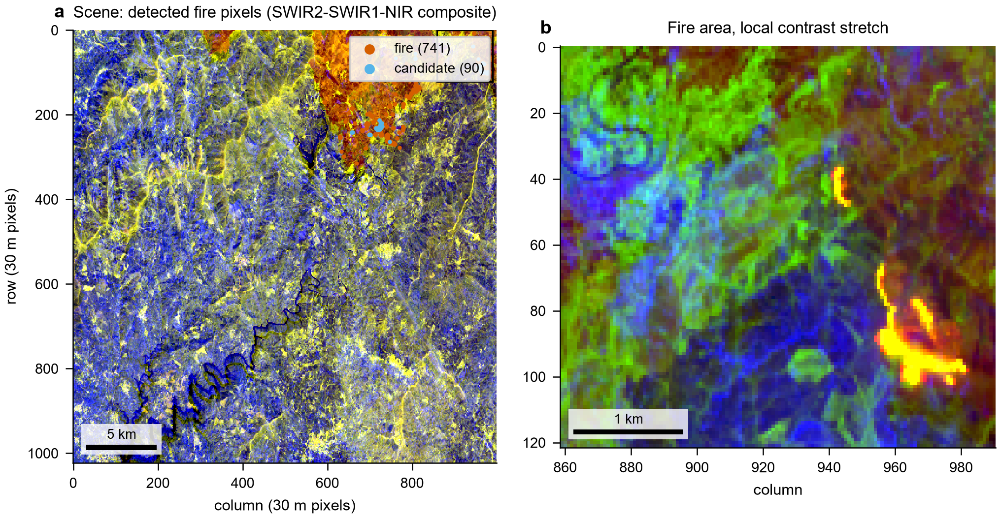
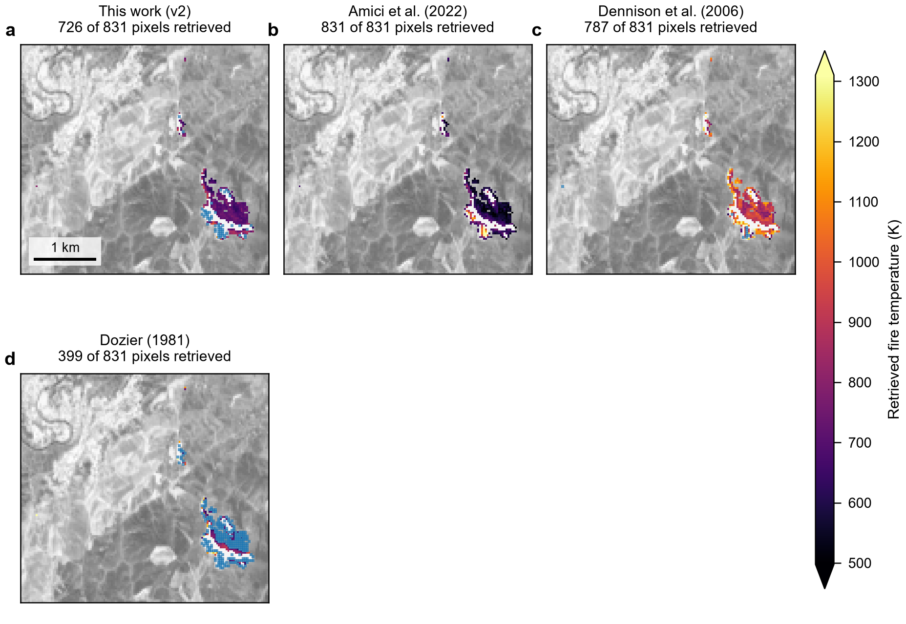
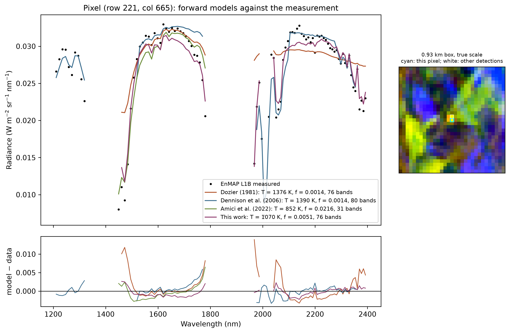
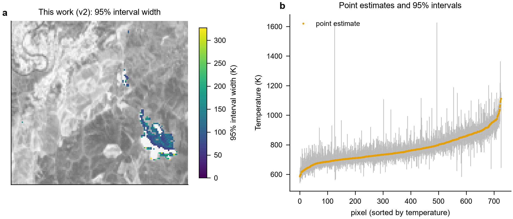
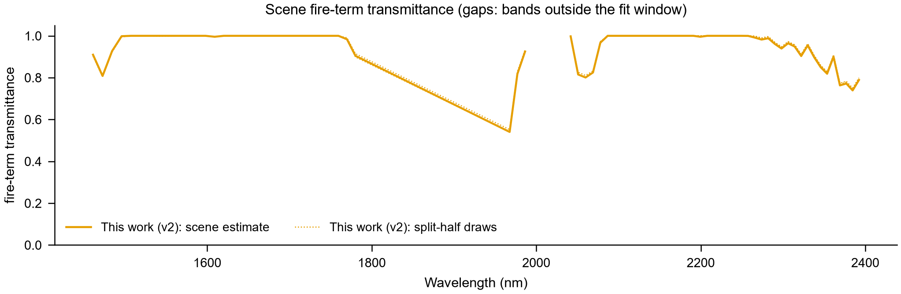

# EnMAP Wildfire Temperature

*Sub-pixel fire detection and temperature retrieval from EnMAP hyperspectral imagery*

[](environment.yml)
[](LICENSE)
[](https://www.enmap.org/)

EnMAP Wildfire Temperature is an open-source Python pipeline for finding active fire pixels in an EnMAP scene and retrieving the temperature, fire fraction, and fire radiative power (FRP) of the sub-pixel fire inside each of them - with a confidence interval for every pixel. It reads a stock DLR EnMAP L1B/L1C radiance product, runs this work's retrieval next to the published VSWIR methods on the same pixels, and validates the result against thermal satellites and active-fire products acquired close in time.

Everything can be run from a desktop GUI or from the command line, and every run ends with a publication-style PDF report of the scene.



*Fire pixels detected in EnMAP datatake DT0000149658, tile 015 (19 August 2025, Arganil / Piódão fire, Coimbra, Portugal). Left: the full tile; right: the fire area with a local contrast stretch.*

## Features

### Fire Detection

- **Scene-wide GLRT detector** (default): a generalised likelihood-ratio test against the scene's own background, with a calibrated per-pixel false-alarm rate (`--p-fa`, default 1e-5, about ten false alarms per tile)
- **Published index detectors**: the two-part SWIR hotspot index with a robust (MAD) or Otsu threshold, kept for comparison
- **Radiance gate**: an absolute SWIR radiance anomaly is required as well, so shadow and water pixels (where the index ratio is noisy) are not picked up
- **L1B quality masks**: invalid and saturated bands are flagged per pixel and per band before any fit

### Temperature Retrieval (this work)

- **Profile-likelihood inversion**: the mixture model is linear in the abundances and nonlinear only in temperature, so the temperature is found by a globally optimal 1-D search instead of a local optimiser with random restarts
- **Scene fire-term transmittance**: the atmospheric transmittance on the fire term is estimated from the scene's own fire pixels, so absorption bands are used rather than thrown away
- **Weighted fit**: an explicit noise plus model-error covariance, so the brightest bands do not dominate the answer
- **95% intervals**: profile-likelihood confidence intervals on temperature for every pixel, plus a likelihood-ratio fire test and a temperature-dependent detection limit
- **Saturated pixels**: rigorous one-sided bounds on temperature and FRP from saturated bands, and two-sided 95% FRP bounds for whole fire clusters

### Published Methods (run exactly as published)

- **Dozier (1981)**: bi-spectral closed-form solution on two SWIR channels
- **Dennison et al. (2006)**: MESMA with a 500-1500 K Planck endmember library
- **Amici et al. (2022)**: multi-trial Planck-mixture fit with image background draws, adapted from the authors' PRISMA code
- **Monte Carlo uncertainty** for Dozier and Dennison, so all methods can be compared with error bars

### Reference Data and Validation

- **Thermal partners**: Landsat 8/9, ECOSTRESS, VIIRS, and Sentinel-3 SLSTR land-surface temperature, found and downloaded automatically for the closest overpass
- **Thermal sharpening**: coarse LST put onto EnMAP's 30 m grid (DisTrad / TsHARP)
- **Active-fire products**: FIRMS, GOES, SLSTR FRP, and SEVIRI (LSA SAF) for an FRP comparison
- **Co-registration**: optional AROSICS alignment of the L1B scene to the nearest cloud-free HLS image before comparing with other satellites
- **Field measurements**: optional CSV of ground temperatures

### Outputs

- **Per-pixel CSVs**: temperature, fire fraction, FRP, interval, and fit diagnostics for every method
- **GeoTIFF temperature maps** on the EnMAP grid
- **Figures**: temperature maps, method agreement, spectral fits, uncertainty, transmittance, and partner comparisons
- **PDF scene report**: one document per scene, with summary statistics and all figures

### Interface

- **Desktop GUI**: a four-page workspace (Scene → References → Retrieval → Run) with live stage progress, log, summary tiles, temperature-map preview, and light / dark themes
- **Accounts window**: archive logins entered once and kept in the standard files (`~/.netrc` or `~/_netrc` for Earthdata and CDSE, `~/.env` for the FIRMS key)

## Example Results

The figures below come from a full pipeline run on the Arganil / Piódão scene shown above.

**Temperature maps from four methods on the same detected pixels.** Blue marks pixels a method could not retrieve, and white marks saturated pixels.



**Forward models against one measured EnMAP spectrum**, with the residuals underneath. Each method uses its own published band set.



**Per-pixel uncertainty from this work's retrieval**: the map of 95% interval widths, and every point estimate with its interval.



**Fire-term transmittance estimated from the scene itself**, with split-half draws to show its stability.



## Pipeline

Each run goes through eight stages, which the GUI ticks off live:

1. **Load** the EnMAP scene (VNIR and SWIR detectors merged and sorted by wavelength)
2. **Detect** fire pixels (GLRT by default) and build the background pool
3. **Reference data** for validation (field measurements, thermal partners)
4. **This work's retrieval**: profile-likelihood inversion with the scene fire-term transmittance
5. **Amici et al. (2022)**: multi-trial Planck-mixture fit (reference method)
6. **Other published methods** and optional corrections
7. **Validation** against the reference data
8. **Outputs**: temperature maps, figures, and the PDF report

## Project Structure

| Path | Contents |
| --- | --- |
| `Fire_analysis_with_EnMAP.py` | Main pipeline - ingestion, detection, Amici et al. (2022) retrieval, validation, outputs, and the CLI |
| `Fire_analysis_with_EnMAP_GUI.py` | Desktop GUI (tkinter / ttk) |
| `fire_detection.py` | Scene-wide GLRT fire detector |
| `profile_retrieval.py` | Profile-likelihood sub-pixel temperature retrieval (this work) |
| `profile_pipeline.py`, `profile_batch.py` | Stage-4 driver and its multi-core execution |
| `fcls_jit.py` | Optional numba-compiled inner solver for the profile grid |
| `fire_transmittance.py` | Scene-adaptive fire-term transmittance |
| `temperature_methods.py` | Published methods (Dozier, Dennison, Amici) behind one common interface |
| `uncertainty.py` | Monte Carlo uncertainty for the published methods |
| `saturation_bounds.py`, `cluster_frp.py` | Bounds from saturated pixels and cluster-level FRP |
| `absorption_window.py` | Temperatures of saturated pixels from the atmospheric absorption bands |
| `enmap_quality.py` | Per-pixel, per-band L1B quality (invalid and saturated bands) |
| `psf.py`, `psf_convex.py` | EnMAP point-spread function and PSF-aware multi-pixel retrieval (experimental) |
| `thermal_partners.py` | Search, download, and load Landsat / ECOSTRESS / VIIRS / SLSTR LST |
| `thermal_sharpening.py` | DisTrad / TsHARP sharpening of coarse LST to 30 m |
| `fire_partners.py` | FIRMS, GOES, SLSTR FRP, and SEVIRI active-fire products |
| `coregistration.py` | AROSICS co-registration against HLS |
| `credentials.py` | Archive logins and keys |
| `scene_report.py` | PDF scene report |
| `solar_time.py` | Local solar time helpers |
| `candidate_sites/` | Search for EnMAP scenes over fires with thermal partners, with site shapefiles |
| `environment.yml` | Conda environment |

## Installation

Create the conda environment (Python 3.11, GDAL, and a pinned OpenBLAS):

```bash
conda env create -f environment.yml
conda activate enmap-fire
```

Then check that LAPACK works before running anything:

```bash
python -c "import numpy as np; np.linalg.inv(np.eye(3)); print('LAPACK ok')"
```

A broken numpy / BLAS link does not raise an error - on Windows the interpreter simply exits (code `0xC06D007F`) with no traceback - so this one-line check saves a lot of confusion.

Optional extras:

```bash
pip install earthaccess   # automatic ECOSTRESS / VIIRS / HLS download (free NASA Earthdata login)
pip install numba         # faster stage 4 (fcls_jit.py); results are identical without it
pip install arosics       # --coregister
```

## Input Data

The retrieval fits Planck radiance to the measured spectrum, so it needs **at-sensor radiance**: an EnMAP **L1B** or **L1C** product. EnMAP **L2A** is surface reflectance and cannot be used - it would give numbers that look like temperatures but are not.

EnMAP data can be ordered for free from the [EOWEB GeoPortal](https://eoweb.dlr.de/) of DLR after registration. Point the pipeline at the product's `*-METADATA.XML` file; the VNIR and SWIR rasters next to it are found and merged automatically.

## Usage

### GUI

```bash
python Fire_analysis_with_EnMAP_GUI.py
```

Pick the scene on the **Scene** page, choose the reference sensors on **References**, set the detector and methods on **Retrieval**, and start the run on **Run**.

### Command Line

A basic run on one scene:

```bash
python Fire_analysis_with_EnMAP.py path/to/ENMAP01-____L1B-DT..._METADATA.XML
```

All published methods, automatic thermal partners, and co-registration:

```bash
python Fire_analysis_with_EnMAP.py path/to/..._METADATA.XML \
    --methods all \
    --landsat-auto-fetch --ecostress-auto-fetch --viirs-auto-fetch \
    --fire-partners FIRMS,SLSTR \
    --coregister
```

Frequently used options:

| Option | What it does |
| --- | --- |
| `--detection {glrt,robust,otsu}` | Fire-pixel detector (default `glrt`) |
| `--p-fa 1e-5` | GLRT per-pixel false-alarm rate |
| `--methods all` | Also run Dozier1981, Dennison2006, Amici2022, and ProfileML through the comparison driver |
| `--landsat / --ecostress / --viirs / --slstr <file>` | Validate against a thermal granule already on disk |
| `--*-auto-fetch` | Find and download the closest thermal granule automatically |
| `--fire-partners FIRMS,GOES,SLSTR,LSASAF` | Active-fire products for the FRP comparison |
| `--coregister` | AROSICS co-registration against HLS before comparison |
| `--results-dir <dir>` | Output folder (default `results_temperature/`) |
| `--no-report` | Skip the PDF report |
| `--serial` | Run on one core |

Run `python Fire_analysis_with_EnMAP.py --help` for the full list.

Results are written to `results_temperature/<scene>/`, one subfolder per scene.

## License

Code in this repository is licensed under the MIT License. See the [LICENSE](LICENSE) file for details.

EnMAP data are © DLR and remain under the EnMAP data license. Landsat, ECOSTRESS, VIIRS, HLS, Sentinel-3, GOES, and SEVIRI products remain under the licenses of their providers.

## Citation

If you use this software in your research, please cite:

```
@software{EnMAPWildfireTemperature2026,
author = {Sharad Kumar Gupta},
title = {EnMAP Wildfire Temperature: Sub-pixel Fire Detection and Temperature Retrieval from EnMAP Hyperspectral Imagery},
year = {2026},
url = {https://github.com/sharadgupta27/EnMAP_Fire_Detection}
}
```

## Acknowledgement

The multi-trial Planck-mixture retrieval of stage 5 is adapted from the PRISMA code released with Amici et al. (2022) ([Zenodo, doi:10.5281/zenodo.7273879](https://doi.org/10.5281/zenodo.7273879)). EnMAP data were provided by the German Aerospace Center (DLR).

1. Amici, S., Spiller, D., Ansalone, L., and Miller, L. (2022). Wildfires temperature estimation by complementary use of hyperspectral PRISMA and thermal (ECOSTRESS & L8). *Journal of Geophysical Research: Biogeosciences*, 127, e2022JG007055.
2. Dennison, P. E., Charoensiri, K., Roberts, D. A., Peterson, S. H., and Green, R. O. (2006). Wildfire temperature and land cover modeling using hyperspectral data. *Remote Sensing of Environment*, 100, 212-222.
3. Dozier, J. (1981). A method for satellite identification of surface temperature fields of subpixel resolution. *Remote Sensing of Environment*, 11, 221-229.

## Author & Contact

Built by **Sharad Kumar Gupta**.

- GitHub: [@sharadgupta27](https://github.com/sharadgupta27)
- LinkedIn: [in/sharadgupta27](https://www.linkedin.com/in/sharadgupta27/)
- Email: [sharadgupta27@gmail.com](mailto:sharadgupta27@gmail.com)
